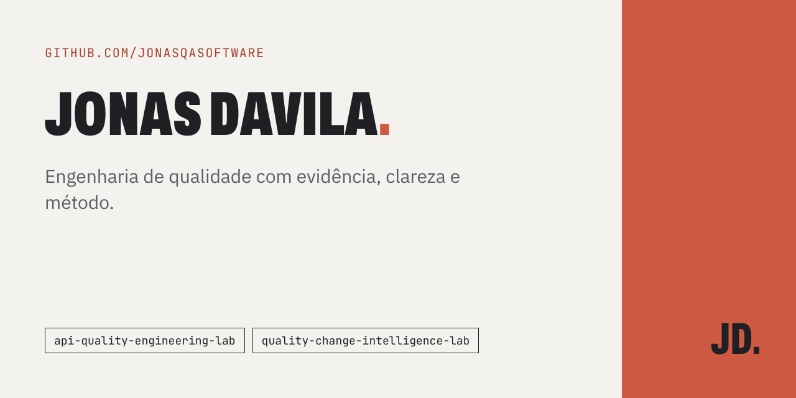

# Safeguard Finance System

<p align="center">
  
</p>

[](https://github.com/jonasqasoftware/safeguard-finance-system/actions/workflows/quality.yml) [](LICENSE) [](https://jonasdavila.com.br/en/)

> **In English:** A security-focused Quality Engineering lab for a small transactional REST API: threat modeling, negative tests, deterministic error contracts and automated quality gates. An educational project, not production-ready.

A security-focused Quality Engineering lab for a small transactional REST API. The project demonstrates how threat modeling, negative tests, deterministic error contracts, and automated quality gates can turn security requirements into executable evidence.

> This is an educational portfolio project, not a production banking platform. Transactions are held in memory and disappear when the process restarts. It makes no claim of regulatory certification or penetration-test coverage.

## Why this project exists

The lab prioritizes high-risk behavior: authentication bypass, token tampering, malicious input, oversized or malformed requests, abusive request volume, insecure defaults, and accidental secret disclosure. Each control has a corresponding automated check where practical.

## Architecture

```text
HTTP request
  -> Helmet + JSON size limit + rate limiter
  -> request correlation
  -> authentication boundary (JWT)
  -> validation and text sanitization
  -> in-memory transaction store
  -> stable JSON response
```

The intentionally small architecture keeps the security decisions reviewable. If a database is added, parameterized queries and least-privilege database credentials must be the primary SQL-injection controls; the current suspicious-input rule is only an educational boundary check.

## Run locally

Requirements: Node.js 20 or newer.

```bash
npm ci
cp .env.example .env
```

Export the values from `.env` in your shell, then start the API:

```bash
set -a && source .env && set +a
npm start
```

The process fails closed if credentials or the JWT secret are absent. Never commit `.env`.

## API

| Method | Route               | Authentication | Purpose                        |
| ------ | ------------------- | -------------- | ------------------------------ |
| `GET`  | `/health`           | No             | Liveness signal                |
| `POST` | `/api/auth/login`   | No             | Issue a 15-minute JWT          |
| `GET`  | `/api/transactions` | Bearer token   | List in-memory transactions    |
| `POST` | `/api/transactions` | Bearer token   | Validate and add a transaction |

Example login:

```bash
curl -s http://localhost:3000/api/auth/login \
  -H 'content-type: application/json' \
  -d '{"username":"quality-admin","password":"replace-this-password"}'
```

## Quality evidence

```bash
npm run validate
npm audit --omit=dev
```

`validate` enforces linting, formatting, and tests with Node's built-in coverage report. Tests exercise positive and negative authentication, forged and missing tokens, SQL-shaped input, XSS-shaped markup, malformed JSON, validation, rate limiting, headers, request correlation, and the authenticated transaction flow.

See [Quality Strategy](docs/QUALITY_STRATEGY.md) for the risk-to-test matrix and [Threat Model](docs/THREAT_MODEL.md) for trust boundaries, mitigations, and residual risks.

## Security design notes

- Secrets and administrator credentials are injected through environment variables.
- JWT verification pins issuer, audience, and `HS256`; tokens expire after 15 minutes.
- Credential comparison uses fixed-length digests and timing-safe comparison.
- Helmet supplies defensive HTTP headers; Express implementation headers are disabled.
- Bodies are limited to 10 KB and requests are rate-limited.
- Free text is stripped of executable markup before storage.
- Request logs contain metadata and correlation IDs, not credentials or tokens.

Output encoding remains the responsibility of any client rendering API values. The project does not store cardholder data, encrypt persisted records, implement OAuth, or demonstrate PCI DSS/GDPR compliance.

## Contributing

Read [CONTRIBUTING.md](CONTRIBUTING.md). Security reports should avoid including live credentials, tokens, or personal data.

## License

MIT — see [LICENSE](LICENSE).
